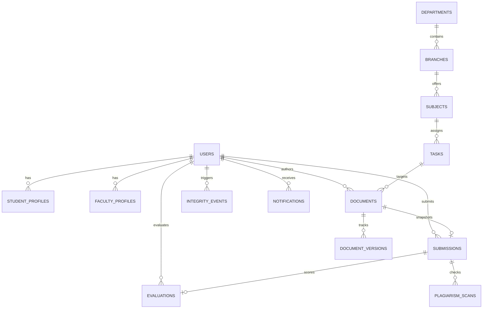

# WriteUp Pro — Relational Database Schema Documentation (DATABASE_SCHEMA.md)

## 1. Overview
The WriteUp Pro persistence layer uses a normalized relational architecture. It runs on SQLite for zero-friction local execution and development, with strict schema compatibility for PostgreSQL in production.

---

## 2. Entity-Relationship Diagram

---

## 3. Data Dictionary

### 3.1 `users`
Core user identity and credentials.
- `id` (TEXT, PK): Unique user ID (e.g. `user_student`, `user_faculty`, `user_admin`).
- `username` (TEXT, UNIQUE, NOT NULL): Login username.
- `email` (TEXT, UNIQUE, NOT NULL): Institutional email address.
- `full_name` (TEXT, NOT NULL): User's legal name.
- `hashed_password` (TEXT, NOT NULL): PBKDF2-HMAC-SHA256 hashed password string (`salt:key`).
- `role` (TEXT, NOT NULL): `student`, `faculty`, or `admin`.
- `status` (TEXT, NOT NULL): `active`, `pending`, `suspended`, or `rejected`.
- `created_at` (TEXT, NOT NULL): ISO 8601 UTC timestamp.
- `updated_at` (TEXT, NOT NULL): ISO 8601 UTC timestamp.

### 3.2 `student_profiles`
Academic enrollment and grouping details for students.
- `user_id` (TEXT, PK, FK $\to$ `users.id`): Associated student ID.
- `roll_number` (TEXT, NOT NULL): Institutional student roll number (e.g. `21CE104`).
- `prn` (TEXT): Permanent Registration Number.
- `year_level` (TEXT, NOT NULL): Academic year (`FE`, `SE`, `TE`, `BE`).
- `branch_code` (TEXT, NOT NULL): Department branch (`CE`, `IT`, `ASH`).
- `semester_number` (INTEGER, NOT NULL): Current semester (1 to 8).
- `division_name` (TEXT, NOT NULL): Classroom division (`Div A`, `Div B`).
- `elective_subject` (TEXT): Selected open elective course.
- `status` (TEXT, NOT NULL): `pending`, `approved`, `rejected`, or `blocked`.
- `admin_remarks` (TEXT): Feedback/discrepancy notes recorded during approval/rejection.
- `created_at` (TEXT, NOT NULL): ISO 8601 UTC timestamp.
- `updated_at` (TEXT, NOT NULL): ISO 8601 UTC timestamp.

### 3.3 `faculty_profiles` & `faculty_assignments`
- `faculty_profiles`: Maps faculty to employee ID, department, and designation.
- `faculty_assignments`: Relational mapping of faculty members to authorized subjects and classroom divisions.

### 3.4 `departments`, `branches`, `academic_years`, `divisions`, `subjects`
Institutional academic hierarchy:
- `departments`: Institutional departments (`Computer Engineering`, `Information Technology`).
- `branches`: Academic branches associated with departments.
- `subjects`: Curriculum courses with subject codes (`CE-DS201`, `CE-DB201`), semester numbers, and elective flags.

### 3.5 `tasks`
Academic assignments and experiments published by faculty or administrators.
- `id` (TEXT, PK): Unique task ID.
- `title` (TEXT, NOT NULL): Task name.
- `description` (TEXT): Task overview.
- `subject_id` (TEXT, FK $\to$ `subjects.id`): Associated subject.
- `faculty_id` (TEXT, FK $\to$ `users.id`): Publishing faculty member.
- `task_type` (TEXT, NOT NULL): `Assignment` or `Experiment`.
- `task_number` (TEXT, NOT NULL): Assignment/Experiment number.
- `max_marks` (REAL, NOT NULL): Maximum marks ($10.0$ for Assignment, $15.0$ for Experiment).
- `instructions` (TEXT): Detailed submission instructions.
- `due_date` (TEXT, NOT NULL): Submission deadline.
- `rubric_json` (TEXT, NOT NULL): Configurable rubric criteria matrix JSON.
- `status` (TEXT, NOT NULL): `published`, `draft`, or `closed`.

### 3.6 `documents` & `document_versions`
Student write-up drafts and version snapshots.
- `documents`: Working document entity tracking `content_html`, word count, and status (`draft`, `submitted`, `graded`, `returned`).
- `document_versions`: Incremental version snapshots preserving content history and change summaries.

### 3.7 `submissions`
Immutable frozen snapshots created upon document submission.
- `id` (TEXT, PK): Unique submission ID.
- `document_id` (TEXT, FK $\to$ `documents.id`): Reference document.
- `task_id` (TEXT, FK $\to$ `tasks.id`): Associated task.
- `student_id` (TEXT, FK $\to$ `users.id`): Authoring student.
- `submission_code` (TEXT, UNIQUE, NOT NULL): Unique receipt code (e.g. `SUB-2026-IIET-9014`).
- `snapshot_html` (TEXT, NOT NULL): Immutable frozen snapshot of student's write-up.
- `submission_date` (TEXT, NOT NULL): Formatted submission date.
- `is_late` (INTEGER, NOT NULL DEFAULT 0): Late submission indicator.
- `status` (TEXT, NOT NULL): `submitted`, `graded`, or `returned`.

### 3.8 `evaluations`
Faculty evaluation scores and digital approval records.
- `id` (TEXT, PK): Unique evaluation ID.
- `submission_id` (TEXT, UNIQUE, FK $\to$ `submissions.id`): Evaluated submission.
- `faculty_id` (TEXT, FK $\to$ `users.id`): Evaluator.
- `marks_awarded` (REAL, NOT NULL): Total score.
- `max_marks` (REAL, NOT NULL): Maximum permissible marks.
- `rubric_scores_json` (TEXT, NOT NULL): Score breakdown by rubric criterion.
- `feedback` (TEXT): Qualitative student feedback.
- `remarks` (TEXT): Faculty internal notes.
- `digital_signature_code` (TEXT, NOT NULL): Cryptographic digital approval stamp hash (e.g. `SIG-FAC9021-IIET-XXXX`).
- `status` (TEXT, NOT NULL): `approved`, `returned`, or `draft`.
- `evaluated_at` (TEXT, NOT NULL): ISO 8601 UTC timestamp.

### 3.9 `integrity_events`
Anti-cheat telemetry audit records.
- `id` (TEXT, PK): Unique event ID.
- `student_id` (TEXT, FK $\to$ `users.id`): Student.
- `document_id` (TEXT, FK $\to$ `documents.id`): Context document.
- `event_type` (TEXT, NOT NULL): `paste_attempt`, `drop_attempt`, `tab_blur`, `typing_burst`, `large_insertion`.
- `severity` (TEXT, NOT NULL): `low`, `medium`, `high`.
- `metadata_json` (TEXT, NOT NULL): Context telemetry (e.g. blocked characters, burst delta).
- `review_status` (TEXT, NOT NULL): `pending`, `reviewed`, `dismissed`, `investigating`.
- `admin_remarks` (TEXT): Administrative review notes.
- `timestamp` (TEXT, NOT NULL): ISO 8601 UTC timestamp.

### 3.10 `notifications` & `audit_logs`
- `notifications`: User notifications with read/unread tracking and deep links.
- `audit_logs`: Administrative action tracking.
