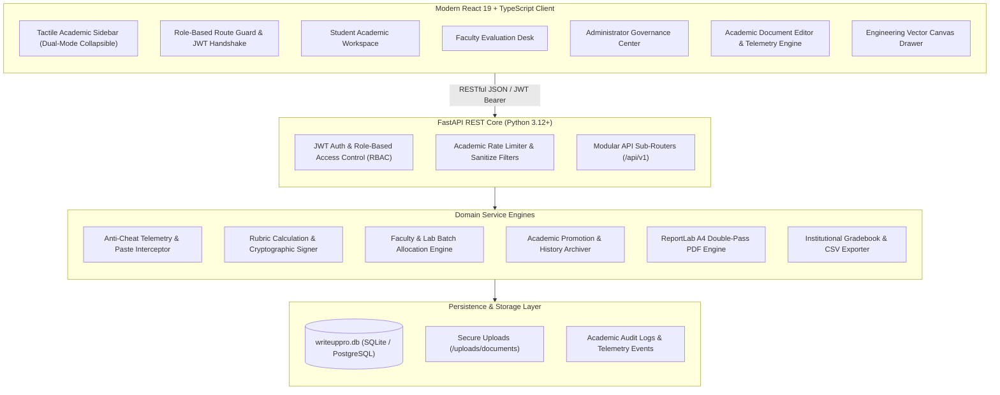
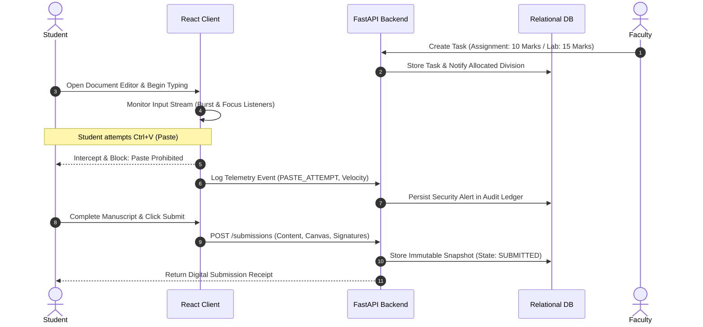
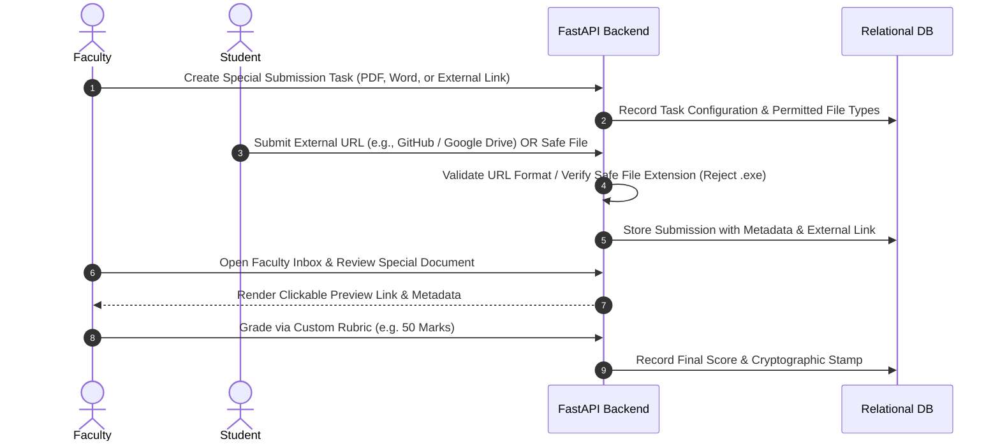
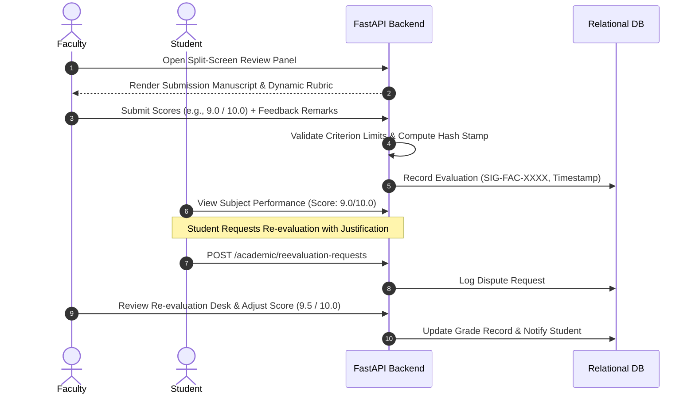
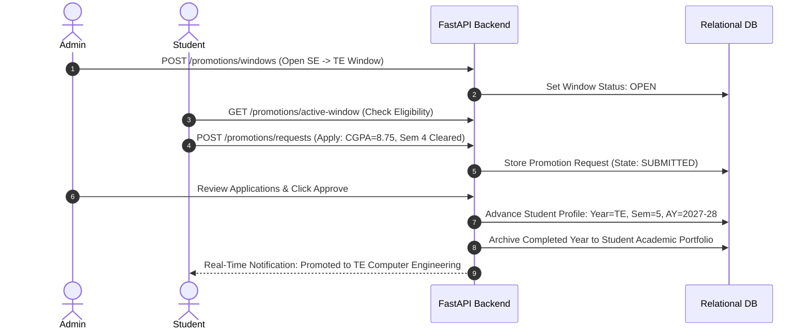

<div align="center">

# WriteUp Pro
### Enterprise Academic Writing, Integrity Monitoring & Institutional Evaluation Platform 📝🏛️

*A Unified, Next-Generation Academic Workspace for Engineering Colleges, Faculty & Students*

[](https://writeuppro-antipaste.vercel.app)
[](http://localhost:8000/docs)
[](https://react.dev)
[](https://tailwindcss.com)
[](https://sqlite.org)
[](http://localhost:8000)

</div>

---

## 📑 Table of Contents

1. [Executive Overview](#-executive-overview)
2. [System Architecture & Data Flow](#-system-architecture--data-flow)
3. [Interactive Sidebar Navigation System (v2.0)](#-interactive-sidebar-navigation-system-v20)
4. [Role-Based Workspaces & Capabilities](#-role-based-workspaces--capabilities)
   - [👨‍🎓 Student Academic Workspace](#-1-student-academic-workspace)
   - [👨‍🏫 Faculty Evaluation Desk](#-2-faculty-evaluation-desk)
   - [🛡️ Administrator Control Center](#-3-administrator-control-center)
5. [End-to-End Academic Workflows](#-end-to-end-academic-workflows)
   - [Workflow 1: Standard Assessment & Telemetry Capture](#workflow-1-standard-assessment--telemetry-capture)
   - [Workflow 2: Special Document Submission (Flexible Formats)](#workflow-2-special-document-submission-flexible-formats)
   - [Workflow 3: Evaluation, Digital Signature & Re-evaluation](#workflow-3-evaluation-digital-signature--re-evaluation)
   - [Workflow 4: Academic Year Promotion Lifecycle](#workflow-4-academic-year-promotion-lifecycle)
6. [Academic Curriculum & Real-World College Logic](#-academic-curriculum--real-world-college-logic)
7. [Default Demo Accounts & Evaluation Credentials](#-default-demo-accounts--evaluation-credentials)
8. [Repository Structure](#-repository-structure)
9. [Installation & Local Setup](#-installation--local-setup)
10. [Docker Container Orchestration](#-docker-container-orchestration)
11. [REST API Reference](#-rest-api-reference)
12. [Verification, Audits & Test Suites](#-verification-audits--test-suites)
13. [Security, Integrity & Data Governance](#-security-integrity--data-governance)
14. [Design System & UI Tokens](#-design-system--ui-tokens)
15. [License & Acknowledgments](#-license--acknowledgments)

---

## 📖 Executive Overview

**WriteUp Pro** is an institutional academic management, document authoring, academic integrity surveillance, and curriculum evaluation platform engineered specifically for engineering universities and technical colleges.

### The Problem It Solves
In modern engineering coursework, laboratory write-ups, code assignments, and technical reports suffer from pervasive academic dishonesty:
- Unchecked copy-pasting from online repositories and generative AI tools.
- Absence of verifiable authorship evidence and time-on-task telemetry.
- Inconsistent rubric application across faculty members.
- Disconnected academic structures where syllabus, lab batches, semester promotions, and marks records exist in fragmented spreadsheets.

### The WriteUp Pro Solution
WriteUp Pro bridges this gap with an integrated, end-to-end platform:
- **Proactive Academic Integrity Engine**: Intercepts unauthorized clipboard events (`Ctrl+V`, context menu paste), drag-and-drop operations, and abnormal keystroke burst velocities (< 30ms interval), recording immutable telemetry logs for faculty review.
- **Strict Academic Marks Pipeline**: Enforces institutional rubric limits—strictly separating **Assignment Marks** (out of 10) from **Laboratory Experiment Marks** (out of 15), while supporting **Special Document Submissions** (up to 100 marks with multi-criteria custom rubrics).
- **Flexible Multi-Format Submissions**: Supports native in-platform word processing, vector engineering canvas diagrams, PDF uploads, Word documents (`.doc`, `.docx`), safe technical files (`.zip`, `.xlsx`, `.ppt`), and external verified links (Google Drive, GitHub, Figma).
- **Real-World College Governance**: Complete administrative tooling including a **10-Step Faculty Allotment Wizard**, **Laboratory Batch Matrix** (A1, A2, A3), **Academic Year Promotion Windows**, **Marks Re-evaluation Desks**, and **Student Academic Portfolios**.

---

## 🏛️ System Architecture & Data Flow



### Technology Stack

| Layer | Technology | Version | Purpose |
| :--- | :--- | :--- | :--- |
| **Frontend Framework** | React + TypeScript | 19.x / 5.7+ | Component architecture, strict type checking, high responsiveness |
| **Bundler & Tooling** | Vite | 8.x | Instant HMR development, optimal production tree-shaken bundles |
| **CSS & Design** | Tailwind CSS | v4.x | Neo-brutalist academic typography, high-contrast borders, dark mode |
| **Icons & Assets** | Lucide React | Latest | Crisp academic, file, and navigation iconography |
| **Backend Framework** | FastAPI (ASGI) | 0.115+ | High-performance asynchronous Python REST API with automatic OpenAPI specs |
| **Server Engine** | Uvicorn | Latest | Production-grade ASGI server runner |
| **Data Validation** | Pydantic | v2.x | Request/response data models, schema generation, type coercion |
| **Database** | SQLite / PostgreSQL | 3.x / 16+ | ACID-compliant relational schema, foreign key constraints, transactions |
| **PDF Rendering** | ReportLab | 4.x | Authentic A4 institutional grade sheets, cover pages, and portfolios |
| **Containerization** | Docker & Compose | Latest | Reproducible, isolated multi-service full-stack deployment |

---

## 🧭 Interactive Sidebar Navigation System (v2.0)

WriteUp Pro features a dedicated, responsive, tactile-academic **Sidebar Navigation System** matching the platform's neo-brutalist institutional aesthetic.

```
┌────────────────────────────────────────────────────────┐
│ [W] WRITEUP PRO v2.0                       [<] Collapse │
├────────────────────────────────────────────────────────┤
│ [D] Demo Student // STUDENT (21CE104)                  │
├────────────────────────────────────────────────────────┤
│ [+ NEW WRITEUP]                                        │
├────────────────────────────────────────────────────────┤
│ WORKSPACE                                              │
│   📁 My Workspace                                      │
│   📖 My Subjects                                       │
│ ASSESSMENTS                                            │
│   ☑️ Assignments                                       │
│   🧪 Lab Experiments                                   │
│   ✨ Special Submissions                               │
│   📄 Submissions & Grades                              │
│ ACADEMIC PROGRESS                                      │
│   🏆 Subject Performance (Marks Breakdown)             │
│   📅 Academic Calendar                                 │
│   🎓 Student Portfolio (PDF Export)                    │
│ ADMINISTRATION                                         │
│   🔀 Open Electives                                    │
│   📈 Year Promotion                                    │
├────────────────────────────────────────────────────────┤
│ 🟢 AY 2026-27 Active                              v2.0 │
│ [ ☀️ LIGHT ]                         [ 🚪 EXIT ]       │
└────────────────────────────────────────────────────────┘
```

### Key Capabilities
1. **Dual-Mode Desktop Collapsible**:
   - **Expanded Mode (`256px`)**: Complete navigation groups, badges, profile details, and quick action CTA.
   - **Compact Icon Mode (`80px`)**: Space-saving icon bar with full interactive tooltips, centered chevrons, and retained navigation functionality. Collapse preference automatically persists in `localStorage`.
2. **Mobile Off-Canvas Drawer**:
   - Opens as a slide-out drawer on mobile and tablet screens via the header hamburger menu button, complete with dark backdrop overlay.
3. **Distraction-Free Authoring Integration**:
   - The sidebar automatically retracts when a student enters the full **Document Authoring Editor**, giving students maximum screen width for writing and engineering diagramming.
4. **Role-Tailored Menus**: Navigation dynamically switches to display only relevant academic options for Students, Faculty, or Administrators.

---

## 💼 Role-Based Workspaces & Capabilities

### 👨‍🎓 1. Student Academic Workspace

- **Subject-wise Academic Performance**:
  - Displays every allotted subject (e.g. *Data Structures & Analysis*, *Computer Networks*).
  - **Strict Separation of Marks**: Displays **Assignment Marks** (obtained / max, total, and average) strictly separated from **Laboratory Experiment Marks** (obtained / max, total, and average).
  - Displays **Special Document Submissions** with title, status, evaluation feedback, and obtained marks.
  - Formatted in actual academic marks rather than misleading percentage compressions.
- **Academic Writing Processor**:
  - Full-featured WYSIWYG editor with Heading 1/2, bold, italic, lists, inline tables, and code snippets.
  - Automatic institutional cover page generation featuring college logos, student metadata, and marking rubrics.
  - Debounced background autosave with version recovery.
- **Engineering Vector Canvas**:
  - Built-in drawing studio for architectural diagrams, circuit diagrams, and flowcharts.
  - Supports shapes, lines, arrows, freehand sketching, grid snapping, and one-click embedding into the manuscript.
- **Flexible Document Submissions**:
  - Upload PDF or Word documents (`.doc`, `.docx`).
  - Upload safe supplementary files (`.zip`, `.xlsx`, `.ppt`, `.png`, `.jpg`).
  - Submit external verified links (Google Docs, Google Drive, OneDrive, GitHub, Figma) with clickable instructor previews.
- **Unified Academic Calendar**:
  - Month and list views of assignment deadlines, lab experiment turn-in dates, exam dates, and announcements.
- **Student Academic Portfolio**:
  - Consolidates complete academic history: semester-wise enrolled subjects, CGPA history, assignment scores, lab marks, certifications, and faculty remarks.
  - One-click institutional **A4 PDF Export**.

---

### 👨‍🏫 2. Faculty Evaluation Desk

- **Curriculum & Teaching Folders**:
  - Submissions automatically categorized by Class, Semester, Branch, and Division (e.g., `SE Comp Eng - Div A`).
  - View enrolled student counts, submission rates, pending reviews, and graded tallies.
- **Split-Screen Evaluation Workspace**:
  - Side-by-side view: student manuscript on the left, interactive grading rubric on the right.
  - Enforces university maximum score limits:
    - **Assignments (10 Marks)**: Understanding (4), Content (3), Punctuality (3).
    - **Experiments (15 Marks)**: Setup (5), Conduction (5), Viva & Output (5).
    - **Custom Rubrics**: Fully configurable multi-tier grading rubrics for special projects.
- **Cryptographic Digital Signature**:
  - Automatically calculates and stamps an authentic digital signature (e.g., `SIG-FAC9021-IIET-XXXX`) with timestamp upon grading.
- **Task Management & Deadline Extensions**:
  - Create and publish Assignments, Lab Experiments, or Special Submissions.
  - Modify instructions, update attachments, or extend deadlines with recorded justification reasons.
- **Marks Re-evaluation Desk**:
  - Review student re-evaluation dispute requests with original score, student justification, updated marks, and faculty remarks.

---

### 🛡️ 3. Administrator Control Center

- **10-Step Faculty Subject Allotment Wizard**:
  - Step-by-step institutional workflow matching college registrar standards: Academic Year Selection $\rightarrow$ Department $\rightarrow$ Semester $\rightarrow$ Subject Selection $\rightarrow$ Faculty Assignment $\rightarrow$ Lab Batch Scoping $\rightarrow$ Workload Verification $\rightarrow$ Final Commit.
- **Laboratory Batch Matrix**:
  - Manage practical batches (e.g., A1, A2, A3) and perform manual or automated student roll-number allocations.
- **Academic Year Promotion Governance**:
  - Configure, open, close, and manage Year Promotion Windows (Draft $\rightarrow$ Scheduled $\rightarrow$ Open $\rightarrow$ Closed $\rightarrow$ Archived).
  - Set eligibility criteria (minimum CGPA, permitted KT/backlog counts).
  - Review student promotion applications, approve upgrades to the next academic year (FE $\rightarrow$ SE $\rightarrow$ TE $\rightarrow$ BE), and archive past academic history.
- **Student Registration & Verification**:
  - Verify new student profiles, validate PRN/Roll Number uniqueness, approve active enrollment, or revert applications with discrepancy feedback.
- **Security & Anti-Cheat Telemetry Ledger**:
  - Centralized ledger auditing all intercepted telemetry events across the campus: paste attempts, drag drops, window focus loss, and abnormal typing speeds.
- **Institutional Governance & Backups**:
  - Export institutional gradebooks to CSV.
  - On-demand database backups and one-click clean demo resets.

---

## 🔄 End-to-End Academic Workflows

### Workflow 1: Standard Assessment & Telemetry Capture



### Workflow 2: Special Document Submission (Flexible Formats)



### Workflow 3: Evaluation, Digital Signature & Re-evaluation



### Workflow 4: Academic Year Promotion Lifecycle



---

## 📚 Academic Curriculum & Real-World College Logic

WriteUp Pro aligns strictly with standard university engineering frameworks (such as **Mumbai University Rev-2019 'C' Scheme**):

```
UNIVERSITY OF MUMBAI / IIET ACADEMIC HIERARCHY
├── First Year Engineering (FE)
│   ├── Semester 1 (Applied Mathematics I, Engineering Physics I)
│   └── Semester 2 (Applied Mathematics II, Engineering Chemistry)
├── Second Year Engineering (SE)
│   ├── Semester 3 (Data Structures & Analysis, Computer Networks)
│   └── Semester 4 (Operating Systems, Database Management Systems)
├── Third Year Engineering (TE)
│   ├── Semester 5 (Software Engineering, Theory of Computation)
│   └── Semester 6 (Artificial Intelligence, Cloud Computing)
└── Final Year Engineering (BE)
    ├── Semester 7 (Cybersecurity, Distributed Systems)
    └── Semester 8 (Major Capstone Project, Industry Elective)
```

### Curricular Business Rules
1. **Realistic 2-Subject Combinations**: In our pristine demonstration state, every academic combination (Branch + Year + Semester + Division) features exactly two core curriculum subjects to maintain clean, realistic views.
2. **Strict Marks Partitioning**:
   - **Assignments**: Capped at 10 marks per task.
   - **Laboratory Experiments**: Capped at 15 marks per task.
   - **Special Documents**: Flexible ceiling (typically 25, 50, or 100 marks).
3. **Audit Immutability**: Evaluations and submissions cannot be silently overwritten; all grade changes require verified re-evaluation logs or administrative intervention.

---

## 🔑 Default Demo Accounts & Evaluation Credentials

For seamless evaluation, testing, and jury walkthroughs, the application includes quick role evaluation buttons on the sign-in screen.

**Global Password for all demonstration accounts:** `password`

| Role | Username | Password | Assigned Department / Division / Class | Key Responsibilities |
| :--- | :--- | :--- | :--- | :--- |
| **Student** | `student` | `password` | Computer Engineering, SE, Div A, Sem 3 (Roll: `21CE104`) | Drafts assignments, draws canvas diagrams, views marks breakdown, submits portfolio |
| **Faculty** | `faculty` | `password` | Department of Computer Engineering (`EMP-COMP-001`) | Manages SE Div A classes, evaluates submissions, creates rubrics, extends deadlines |
| **Administrator** | `admin` | `password` | Institutional Control Center | Allotment wizard, lab batches, year promotions, audit logs, database backups |

> [!TIP]
> **One-Click Demo Reset**: To reset all student submissions, tasks, evaluations, and test artifacts back to a pristine 10-student, 3-faculty baseline, click the **Reset Demo State** button in the Administrator Control Center, or make an authorized `POST` request to `/api/v1/academic/admin/reset-demo-data`.

---

## 📁 Repository Structure

```text
writeuppro-antipaste/
│
├── backend/                              # FastAPI REST API Backend
│   ├── app/
│   │   ├── api/v1/
│   │   │   ├── endpoints/
│   │   │   │   ├── academic.py           # Curriculum, subjects, allotments, batches & promotions
│   │   │   │   ├── analytics.py          # Classroom metrics & grade distributions
│   │   │   │   ├── auth.py               # JWT login, registration & profile retrieval
│   │   │   │   ├── documents.py          # Academic word processor drafts & snapshots
│   │   │   │   ├── evaluations.py        # Split-screen rubric grading & digital signatures
│   │   │   │   ├── exports.py            # Gradebook CSV & institutional reports
│   │   │   │   ├── integrity.py          # Anti-cheat telemetry ingestion & event ledger
│   │   │   │   ├── notifications.py      # Real-time institutional dispatch notifications
│   │   │   │   ├── special_submissions.py# Multi-format document submission endpoints
│   │   │   │   ├── submissions.py        # Task turn-in receipts & snapshot storage
│   │   │   │   └── tasks.py              # Assignment & Experiment authoring endpoints
│   │   │   └── router.py                 # Master v1 API router aggregation
│   │   ├── core/
│   │   │   ├── config.py                 # Environment settings & token parameters
│   │   │   ├── database.py               # SQLite / PostgreSQL thread-safe connection pool
│   │   │   └── security.py               # PBKDF2 password hashing & JWT token encoding
│   │   ├── schemas/
│   │   │   └── models.py                 # Pydantic v2 schemas for all payloads
│   │   ├── services/
│   │   │   ├── export_service.py         # CSV gradebook streaming
│   │   │   ├── pdf_service.py            # ReportLab double-pass A4 PDF compiler
│   │   │   └── similarity_service.py     # Document similarity & ngram analysis
│   │   └── main.py                       # ASGI app initialization & SPA static file serving
│   ├── test_full_audit.py                # 9-Suite End-to-End Regression Test Suite
│   ├── test_practicality_simulation.py   # 12-Step Real-World College Acceptance Simulation
│   ├── writeuppro.db                     # Relational database file
│   ├── requirements.txt                  # Python dependencies
│   └── Dockerfile                        # Backend container specification
│
├── frontend/                             # Modern React 19 + TypeScript SPA
│   ├── src/
│   │   ├── components/
│   │   │   ├── Sidebar.tsx               # Tactile academic sidebar (Dual-Mode Collapsible)
│   │   │   ├── StudentWorkspace.tsx      # Student desk, subjects, performance & portfolio
│   │   │   ├── DocumentEditor.tsx        # Anti-paste word processor & cover sheet generator
│   │   │   ├── DrawingCanvas.tsx         # Vector engineering diagramming studio
│   │   │   ├── FacultyWorkspace.tsx      # Split-screen evaluation desk & custom rubrics
│   │   │   ├── AdminWorkspace.tsx        # Allotment wizard, lab batches & audit ledgers
│   │   │   ├── AdminPromotionManagement.tsx# Promotion upgrade window management
│   │   │   ├── ErrorBoundary.tsx         # Graceful UI crash protection boundary
│   │   │   └── RichTextEditor.tsx        # Modular WYSIWYG formatted text area
│   │   ├── lib/
│   │   │   └── api.ts                    # Strongly typed API client with JWT interception
│   │   ├── styles/
│   │   │   └── index.css                 # Neo-brutalist theme tokens & Tailwind v4 styles
│   │   ├── types/
│   │   │   └── index.ts                  # Shared TypeScript interfaces & models
│   │   ├── App.tsx                       # Master layout, router, notifications & jury panel
│   │   └── main.tsx                      # DOM entrypoint
│   ├── package.json                      # Node.js dependencies & build scripts
│   ├── vite.config.ts                    # Vite configuration with proxy rules
│   └── Dockerfile                        # Frontend production container specification
│
├── docs/                                 # Architectural documentation & manuals
├── docker-compose.yml                    # Multi-container orchestration specification
├── .env.example                          # Environment variable configuration template
└── README.md                             # Comprehensive platform documentation
```

---

## 🛠️ Installation & Local Setup

### Prerequisites
- **Python**: Version 3.11, 3.12, or higher
- **Node.js**: Version 18.0 or higher
- **npm** or **yarn**

### 1. Backend Setup

```bash
# Clone the repository
git clone https://github.com/your-org/writeuppro-antipaste.git
cd writeuppro-antipaste

# Create and activate a Python virtual environment
python -m venv .venv

# On Windows:
.\.venv\Scripts\activate

# On Linux / macOS:
source .venv/bin/activate

# Install backend dependencies
pip install -r backend/requirements.txt

# Run backend regression tests to verify environment
python backend/test_full_audit.py

# Launch the FastAPI ASGI server
uvicorn app.main:app --app-dir backend --reload --host 127.0.0.1 --port 8000
```
- **Backend API**: `http://127.0.0.1:8000`
- **Swagger Documentation**: `http://127.0.0.1:8000/docs`
- **ReDoc Documentation**: `http://127.0.0.1:8000/redoc`

---

### 2. Frontend Setup

Open a new terminal session:

```bash
cd writeuppro-antipaste/frontend

# Install Node dependencies
npm install

# Start Vite development server with Hot Module Replacement (HMR)
npm run dev
```
- **Frontend Application**: `http://localhost:3000`

---

## 🐳 Docker Container Orchestration

To run the complete full-stack environment using Docker and Docker Compose:

```bash
# Build and start all services in the background
docker-compose up --build -d

# View container logs
docker-compose logs -f
```

- **Frontend Application**: `http://localhost:3000`
- **Backend API Core**: `http://localhost:8000`
- **Interactive OpenAPI Explorer**: `http://localhost:8000/docs`

To stop the containers:
```bash
docker-compose down
```

---

## 📡 REST API Reference

The FastAPI backend exposes modular REST endpoints documented via OpenAPI 3.0 at `/docs`. Below is a reference of primary institutional endpoints:

### Authentication & Profiles (`/api/v1/auth`)
| Method | Endpoint | Access | Description |
| :--- | :--- | :--- | :--- |
| `POST` | `/api/v1/auth/login` | Public | Authenticates credentials and returns JWT Bearer access token |
| `POST` | `/api/v1/auth/register` | Public | Self-registration for student and faculty accounts |
| `GET` | `/api/v1/auth/me` | Authenticated | Retrieves current authenticated session user and profile |

### Academic Hierarchy & Governance (`/api/v1/academic`)
| Method | Endpoint | Access | Description |
| :--- | :--- | :--- | :--- |
| `GET` | `/api/v1/academic/student/enrolled-subjects` | Student | Returns subjects allotted to the logged-in student |
| `GET` | `/api/v1/academic/student/academic-performance` | Student | Computes detailed Subject-wise marks (Assignments vs Experiments) |
| `GET` | `/api/v1/academic/student/academic-portfolio` | Student | Consolidates academic history, subjects, and feedback |
| `GET` | `/api/v1/academic/calendar/events` | All Roles | Unified calendar of deadlines, experiments, and exam dates |
| `POST` | `/api/v1/academic/allotments/wizard` | Admin | 10-step institutional faculty-subject allocation wizard |
| `GET` | `/api/v1/academic/batches` | Admin / Faculty | Lists practical laboratory batches (A1, A2, A3) |
| `POST` | `/api/v1/academic/batches/allocate` | Admin | Allocates students to specific laboratory batches |
| `GET` | `/api/v1/academic/promotions/windows` | Admin | Lists configured promotion upgrade windows |
| `POST` | `/api/v1/academic/promotions/windows` | Admin | Creates, opens, or schedules a promotion upgrade window |
| `PATCH`| `/api/v1/academic/promotions/windows/{id}/status` | Admin | Transitions promotion window status (e.g. open $\rightarrow$ closed) |
| `POST` | `/api/v1/academic/reevaluation-requests` | Student | Submits a formal marks dispute / re-evaluation request |
| `PATCH`| `/api/v1/academic/reevaluation-requests/{id}/review` | Faculty | Reviews and updates marks with written justification |
| `POST` | `/api/v1/academic/admin/reset-demo-data` | Admin | Resets database to clean 10-student, 3-faculty baseline |

### Tasks & Submissions (`/api/v1/tasks`, `/api/v1/submissions`, `/api/v1/special-submissions`)
| Method | Endpoint | Access | Description |
| :--- | :--- | :--- | :--- |
| `POST` | `/api/v1/tasks` | Faculty | Creates a new Assignment or Laboratory Experiment |
| `PATCH`| `/api/v1/tasks/{id}/deadline` | Faculty | Extends an assessment deadline with justification |
| `POST` | `/api/v1/submissions` | Student | Submits an in-platform manuscript with snapshot receipt |
| `POST` | `/api/v1/special-submissions/create` | Faculty | Creates a Special Document task with flexible formats |
| `POST` | `/api/v1/special-submissions/submit` | Student | Submits PDF, Word, safe file, or external project link |
| `POST` | `/api/v1/evaluations` | Faculty | Evaluates submission against rubric and applies digital signature |

---

## 🧪 Verification, Audits & Test Suites

WriteUp Pro includes a rigorous multi-tier testing and verification framework.

### 1. Full Audit Regression Suite (`test_full_audit.py`)
Executes 9 automated end-to-end regression test suites:
- **Suite 1**: Authentication, invalid credentials, and RBAC role restrictions (403 Forbidden enforcement).
- **Suite 2**: Pristine demo reset and exact roster count verification (10 Students, 3 Faculty, 1 Admin).
- **Suite 3**: Subject-wise performance calculation and dynamic subject discovery.
- **Suite 4**: Standard Assignment workflow (10-mark maximum score).
- **Suite 5**: Laboratory Experiment workflow (15-mark maximum score and batch allocation).
- **Suite 6**: Academic marks separation verification (Assignments vs Experiments in actual marks).
- **Suite 7**: Promotion window rejection workflow and state preservation.
- **Suite 8**: File upload security and executable extension sanitization (`.exe` rejection).
- **Suite 9**: Safe reset to final pristine demonstration state.

Run the audit suite:
```bash
python backend/test_full_audit.py
```

### 2. Real-World Practicality & College Simulation (`test_practicality_simulation.py`)
Simulates an entire semester's academic lifecycle across 12 sequential real-world steps:
1. Academic Year & Calendar configuration.
2. Subject allotments and faculty scoping.
3. Student subject enrollment verification.
4. Practical batch allocation (Batch A1).
5. Assessment creation (Assignment & Lab Experiment).
6. Task updates & deadline extensions with justification tracking.
7. Special document creation with 50-mark custom rubric.
8. Student multi-format submissions (including GitHub link validation).
9. Faculty grading, rubric checks, and cryptographic signature generation.
10. Marks re-evaluation dispute & resolution workflow.
11. Academic year promotion application, approval, and tier advance (SE $\rightarrow$ TE).
12. Historical academic records preservation in Student Academic Portfolio.

Run the simulation:
```bash
python backend/test_practicality_simulation.py
```

### 3. Frontend Production Build Verification
```bash
cd frontend && npm run build
```
Compiled with **0 TypeScript and Vite compilation errors**.

---

## 🔒 Security, Integrity & Data Governance

| Measure | Implementation Details |
| :--- | :--- |
| **Authentication** | Cryptographic token hashing via PBKDF2-HMAC-SHA256 with dynamic salts. JWT Bearer authorization with short-lived session tokens. |
| **Role-Based Access Control** | Declarative FastAPI dependency injection (`require_roles("admin")`, `require_roles("faculty")`). Unauthorized attempts return strict `403 Forbidden` responses. |
| **Client-Side Telemetry Guard** | Native DOM event interception for `paste`, `drop`, and `beforeinput`. Continuous detection of rapid keystroke bursts (< 30ms) and window blur frequency. |
| **Unsafe File Sanitization** | Uploaded files are strictly validated against an approved MIME type and extension whitelist. Executables (`.exe`, `.sh`, `.bat`) are immediately rejected. |
| **Audit Trails** | All significant administrative and curricular actions (allotments, deadline extensions, marks revisions, promotions) are recorded in immutable audit logs. |
| **Soft Deletion & Recovery** | Curricular records utilize soft-deletion flags to guarantee that student grade history is never permanently corrupted by accidental deletions. |

---

## 🎨 Design System & UI Tokens

WriteUp Pro employs a distinctive **Neo-Brutalist Academic** design aesthetic combining the gravitas of classical university publishing with modern, high-contrast, tactile UI principles.

```
ACADEMIC BRAND COLOR PALETTE
┌───────────────────────┬───────────────────────┬───────────────────────┐
│ #FBF9F3 (Canvas Light)│ #1A1209 (Ink Black)   │ #B84915 (Terracotta)  │
├───────────────────────┼───────────────────────┼───────────────────────┤
│ #1A365D (Oxford Blue) │ #1F5A2E (Forest Sage) │ #8B1A1A (Crimson Seal)│
└───────────────────────┴───────────────────────┴───────────────────────┘
```

- **Borders & Shadows**: High-contrast `2px` solid ink borders (`border-2 border-[#1A1209]`) paired with hard geometric drop shadows (`shadow-[3.5px_3.5px_0px_#1A1209]`).
- **Typography**: Editorial serif headings (`font-serif`) balanced against crisp monospace technical labels (`font-mono`) and clean sans-serif body text.
- **Adaptive Themes**: Complete Light Mode (parchment & ink) and Dark Mode (charcoal slate & amber accent) support toggled instantly via the header or sidebar.

---

## 📄 License & Acknowledgments

This project is licensed under the **MIT License** — see the [LICENSE](LICENSE) file for complete details.

Developed with precision for higher education institutions seeking uncompromised academic integrity and modern productivity. For questions, institutional deployments, or feature requests, please submit an issue or contact the administration team.
