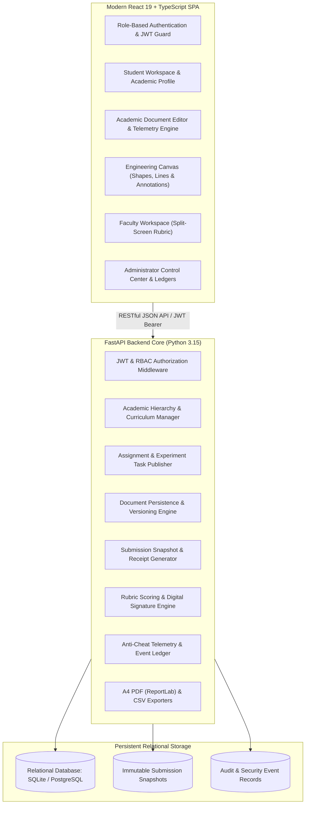

# WriteUp Pro — Smart Academic Writing & Evaluation Platform 📝✨

[](https://fastapi.tiangolo.com)
[](https://react.dev)
[](https://tailwindcss.com)
[](https://sqlite.org)
[](https://www.docker.com)
[](https://pytest.org)

**WriteUp Pro** is a modern, enterprise-grade academic productivity, document authoring, academic integrity monitoring, submission management, faculty evaluation, and institutional administration platform. 

It solves the widespread problem of academic dishonesty and evasion in laboratory write-ups and assignments by enforcing manual authoring, continuous integrity telemetry, and server-side rubric validations—all while delivering an intuitive SaaS experience for students, faculty, and institutional administrators.

---

## 📌 Executive Architecture Overview



---

## 🔑 Default Credentials

For quick evaluation and testing, default institutional accounts are pre-seeded in the database. The password for all pre-configured accounts is: `password`

| Role | Username | Password | Features & Privileges |
| :--- | :--- | :--- | :--- |
| **Student** | `student` | `password` | Academic Profile, Document Editor, Canvas Drawer, Submissions, A4 PDF Downloads |
| **Faculty** | `faculty` | `password` | Classroom Folders, Split-Screen Submission Review, Rubric Evaluation, Digital Approval Stamps |
| **Administrator** | `admin` | `password` | Registration Verification & Reversion, Anti-Cheat Telemetry Ledger, Institutional Grade Book CSV Export |

---

## 🚀 Key Functional Capabilities

### 👨‍🎓 1. Student Workspace & Advanced Document Editor
* **Institutional Setup & Onboarding:** First-time students register their Branch, Year (FE/SE/TE/BE), Semester, Division, and Open Electives. If an application is reverted by an administrator, the student receives discrepancy remarks and pre-filled fields for easy resubmission.
* **Manual Academic Word Processor:** Full formatting toolbar supporting headings (H1, H2), bold, italics, underline, strikethrough, lists, tables, syntax-styled code blocks, and dynamic A4 layout with page zoom controls.
* **Academic Integrity Policy Enforcement:** Strictly intercepts paste (`Ctrl+V`) and drag-and-drop events, monitoring keystroke bursts (< 30ms interval) and window blur/tab switches. All telemetry events are logged to the server-side integrity ledger.
* **Engineering Canvas & Diagram Drawer:** Integrated vector and freehand drawing workspace supporting pen, lines, arrows, rectangles, circles, grid overlays, undo/redo, and direct embedding into academic write-ups.
* **Auto-Generated Cover Pages:** Real-time generation of institutional cover pages including university metadata, student roll numbers, and dynamic rubric matrices for both **Assignments** (10 marks) and **Experiments** (15 marks).
* **Autosave & Version Snapshots:** Background debounced draft persistence with version snapshots ensuring work is never lost.

### 👨‍🏫 2. Faculty Evaluation & Digital Approval Workspace
* **Classroom Folders:** Student submissions are automatically sorted into classroom folders (e.g. `SE - Computer Engineering (Div A)`).
* **Split-View Evaluation Panel:** Evaluates the read-only student submission side-by-side with an interactive grading rubric.
* **Rubric Validation Engine:** Auto-calculates total marks and enforces strict maximum score validations (Knowledge $\le 4$, Content $\le 3$, Punctuality $\le 3$, Performance $\le 5$). Total marks cannot exceed 10 for Assignments or 15 for Experiments.
* **Digital Approval Stamps:** Automatically computes and records a verifiable digital approval signature hash (e.g. `SIG-FAC9021-IIET-XXXX`) and timestamp upon submission finalization.
* **Controlled Resubmission / Return:** Faculty can return documents requiring corrections with remarks, automatically unlocking the student's draft.

### 🛡️ 3. Administrator Control Center & Ledgers
* **Registration Review System:** Review pending student profile registrations. Approve them to grant workspace access, or revert/reject them with custom discrepancy remarks.
* **Security & Integrity Ledger:** Real-time ledger recording telemetry alerts (Paste attempts, Drop attempts, Focus switches, Keystroke bursts) with metadata, severity, and review workflows (Dismiss, Investigate).
* **Institutional Grade Book & CSV Export:** Download comprehensive institutional grade records and integrity logs in standard CSV format.

### 🖨️ 4. Server-Side A4 PDF Generation
* Built with Python **ReportLab**, producing authentic two-pass numbered (`Page X of Y`) institutional PDFs complete with formal cover pages, rubric breakdown tables, rendered write-up content, embedded engineering diagrams, and faculty digital verification stamps.

---

## 📁 Repository Structure

```text
writeuppro-antipaste/
│
├── backend/                       # FastAPI REST API Backend
│   ├── app/
│   │   ├── api/v1/endpoints/      # Modular REST endpoints (auth, academic, tasks, docs, etc.)
│   │   ├── core/                  # Configuration, JWT security & SQLite/Postgres connection
│   │   ├── models/                # Database models & schemas
│   │   ├── schemas/               # Pydantic v2 validation models
│   │   ├── services/              # PDF generation (ReportLab) & CSV export services
│   │   └── main.py                # FastAPI application entrypoint & SPA static server
│   ├── tests/                     # Automated Pytest suite (8 test suites)
│   ├── requirements.txt           # Python dependencies
│   └── Dockerfile                 # Backend container definition
│
├── frontend/                      # Modern React 19 + TypeScript Frontend
│   ├── src/
│   │   ├── components/            # StudentWorkspace, DocumentEditor, FacultyWorkspace, Canvas, Admin
│   │   ├── lib/                   # API client with JWT Bearer authentication
│   │   ├── types/                 # Comprehensive TypeScript interfaces
│   │   ├── styles/                # Tailwind CSS v4 styling & theme tokens
│   │   ├── App.tsx                # Main router, header, notification center & jury panel
│   │   └── main.tsx               # React root entrypoint
│   ├── package.json               # Node.js dependencies
│   ├── vite.config.ts             # Vite bundler configuration
│   └── Dockerfile                 # Frontend multi-stage container
│
├── legacy/                        # Preserved original client-side prototype (index.html)
├── docker-compose.yml             # Full-stack container orchestration
├── .env.example                   # Environment configuration template
└── README.md                      # Documentation
```

---

## 🛠️ Installation & Local Development

### Prerequisites
- **Python**: 3.11 or higher
- **Node.js**: 18.0 or higher
- **npm** or **yarn**

### Quick Start (Full-Stack in 2 Minutes)

#### 1. Setup Backend:
```bash
# Navigate to repository root
cd writeuppro-antipaste

# Create and activate Python virtual environment
python -m venv .venv
# On Windows:
.\.venv\Scripts\activate
# On Linux/macOS:
# source .venv/bin/activate

# Install backend dependencies
pip install -r backend/requirements.txt

# Run backend automated tests
pytest backend/tests/test_api.py -v

# Start the FastAPI backend service
uvicorn app.main:app --app-dir backend --reload --port 8000
```
Backend API will be running at `http://localhost:8000`  
Interactive Swagger API documentation: `http://localhost:8000/docs`

#### 2. Setup Frontend:
```bash
# In a new terminal:
cd writeuppro-antipaste/frontend

# Install dependencies
npm install

# Start Vite development server
npm run dev
```
Frontend will be running at `http://localhost:3000`

---

## 🐳 Running with Docker Compose

To run the entire full-stack platform using Docker:

```bash
docker-compose up --build
```

- **Frontend Application**: `http://localhost:3000`
- **Backend API**: `http://localhost:8000`
- **API Documentation**: `http://localhost:8000/docs`

---

## 🧪 Automated Testing Suite

WriteUp Pro includes automated tests covering authentication, RBAC authorization, document authoring, rubric validation, and PDF/CSV exports:

```bash
.\.venv\Scripts\pytest backend/tests/test_api.py -v
```

Test coverage includes:
- `test_health_check`: Service availability and version metadata.
- `test_auth_login_all_roles`: Token issuance and credential verification for Student, Faculty, and Admin.
- `test_role_authorization_security`: Verification that students are forbidden from administrative endpoints (HTTP 403).
- `test_academic_hierarchy_and_curriculum`: Department, branch, and subject curriculum mapping.
- `test_document_authoring_and_submission_lifecycle`: Draft creation, autosaving, immutable snapshotting, submission receipts, and faculty evaluation.
- `test_rubric_limit_enforcement`: Validation that rubric criteria and maximum marks are strictly enforced on the server.
- `test_integrity_event_logging`: Logging and persistence of paste/telemetry events.
- `test_grading_ledger_csv_export`: Verification of institutional CSV grade archives.

---

## 📄 License

This project is licensed under the MIT License — see the [LICENSE](LICENSE) file for details.
