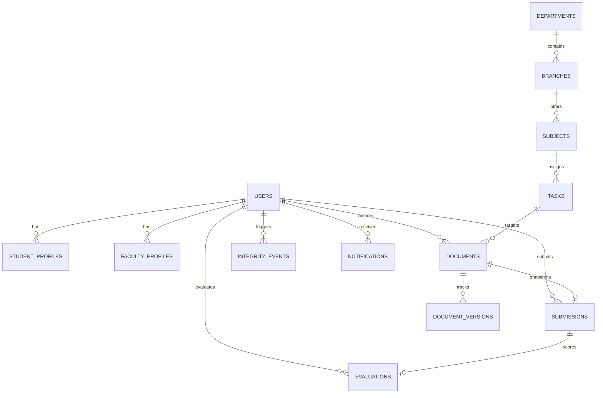

# WriteUp Pro — Architectural Specifications

## 1. Architectural Philosophy
WriteUp Pro is designed around three foundational principles:
1. **Zero-Trust Client Environment**: The browser is treated as an inherently untrusted client. While client-side anti-paste and focus-loss detection provide immediate user feedback and friction, the backend enforces all access boundaries, submission immutability, deadline checks, and rubric limits.
2. **Deterministic Data Integrity**: Every academic submission is captured as an immutable snapshot (`submissions` table) with a unique cryptographic receipt code. Even if a student's working draft changes later, the evaluated document version is frozen.
3. **Institutional Flexibility**: The academic hierarchy (Departments $\to$ Branches $\to$ Semesters $\to$ Divisions $\to$ Subjects $\to$ Electives) is fully relational and dynamic, allowing any college or university to adapt the platform to their specific nomenclature and structure.

---

## 2. Relational Database Entity-Relationship Architecture

---

## 3. Security & Access Control Model

| Endpoint Category | Permitted Roles | Authorization Mechanism |
| :--- | :--- | :--- |
| `/api/v1/auth/*` | Public / Authenticated | PBKDF2-HMAC-SHA256 & JWT Bearer |
| `/api/v1/academic/student-profile` | Student | Enforces profile ownership |
| `/api/v1/academic/student-profiles/*` | Administrator | `require_roles("admin")` |
| `/api/v1/tasks/` | Faculty, Administrator | `require_roles("faculty", "admin")` |
| `/api/v1/documents/*` | Student (Author), Faculty, Admin | Checks student ownership |
| `/api/v1/submissions/*` | Student (Author), Faculty, Admin | Freezes immutable snapshot |
| `/api/v1/evaluations/*` | Faculty, Administrator | Validates rubric sum & digital stamp |
| `/api/v1/integrity/events` | Student (Logging), Admin (Review) | Server-side validation |
| `/api/v1/exports/*` | Authenticated Roles | Streaming binary PDF & CSV |
